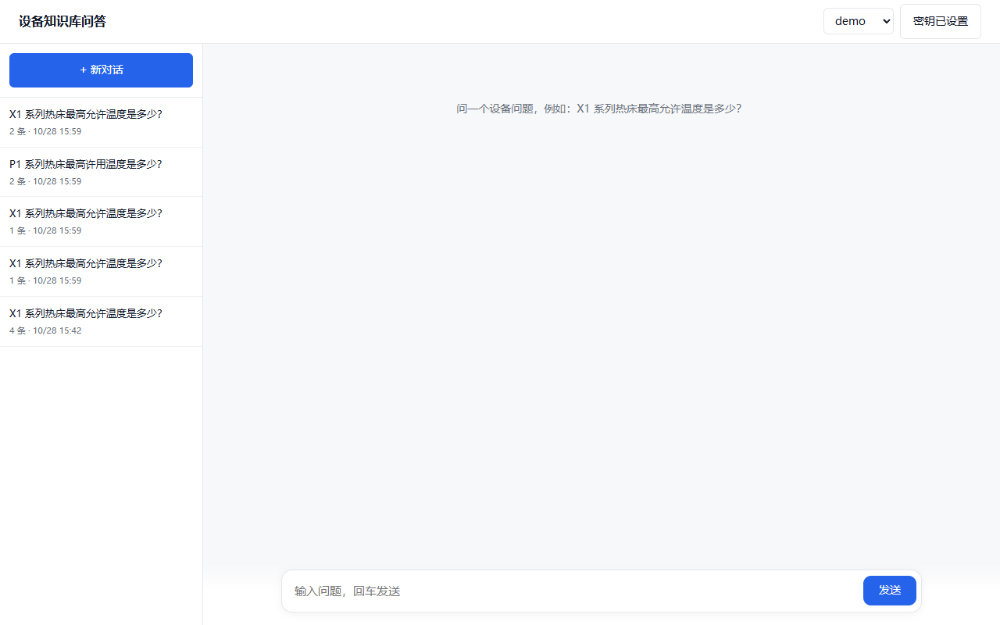
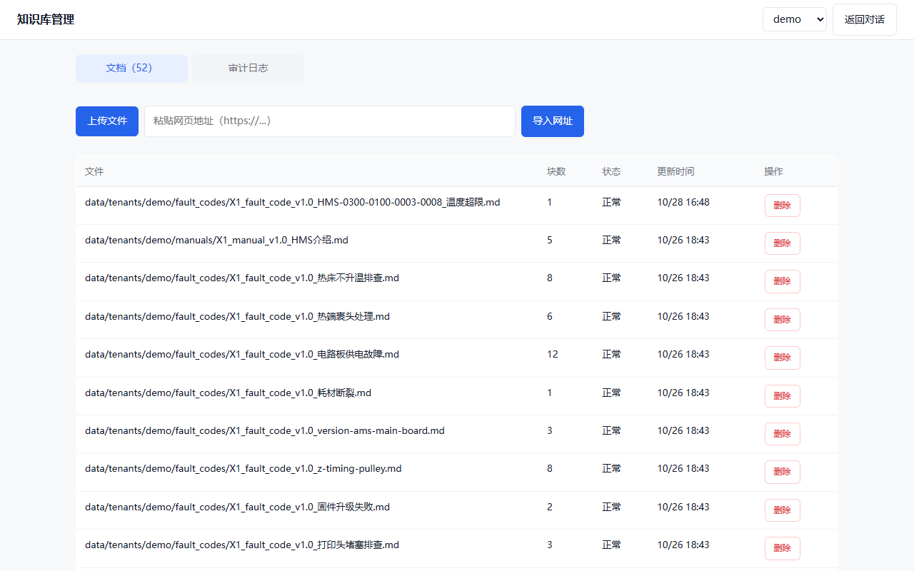

# 制造业设备与工艺知识库

面向制造 / 工业软件场景的**企业知识库问答**：上传设备文档，提问，得到带引用的回答；答不出就明确说「不知道」。
FastAPI + React + Chroma + SQLite，单机可跑，支持最小多租户与管理员后台。

> 回答必须有依据：检索不到就拒答，不编造。



| 文档 | 用途 |
|---|---|
| [`README.md`](README.md) | 项目说明、启动、接口、边界（本文） |
| [`PRD.md`](PRD.md) | 需求、范围、指标、里程碑（唯一真源） |
| [`architecture.md`](architecture.md) | 架构与数据流 |
| [`AGENTS.md`](AGENTS.md) | AI / 开发者入口 |
| [`docs/vibe-coding.md`](docs/vibe-coding.md) | 协作与开发规范 |
| [`docs/设备知识管理规范.md`](docs/设备知识管理规范.md) | 入库、版本、删除、审计、备份规则 |
| [`docs/基线评测报告.md`](docs/基线评测报告.md) | 评测口径与结果 |
| [`docs/模拟内测报告.md`](docs/模拟内测报告.md) | 10 角色 × 100 问的模拟内测 |
| [`development.md`](development.md) | 命令与回归清单 |
| [`TODO.md`](TODO.md) | 当前状态快照 |

---

## 1. 能做什么

| 能力 | 说明 |
|---|---|
| 知识库问答 | 混合检索（向量 + BM25 + RRF），可选重排；弱证据拒答 |
| 引用溯源 | 每条回答附来源文件与片段 |
| 流式输出 | SSE 逐字返回，带延迟与 request id |
| 账号体系 | 注册 / 登录 / 退出；密码 scrypt 哈希；会话 token |
| 数据隔离 | 用户只能看自己的会话；租户由登录身份决定 |
| 会话管理 | 历史列表、置顶、重命名、删除、刷新恢复 |
| 管理员后台 | 文档列表、上传、URL 导入、软删除 / 恢复、审计日志 |
| 反馈闭环 | 点赞点踩落库，作为 badcase 来源 |
| 多租户 | 每租户独立 collection / 语料目录 / 配置 YAML |

**明确没做**：SSO、组织架构、计费、分布式部署、文档在线预览、Word 以外的 Office 格式。

---

## 2. 技术栈

| 层 | 选型 |
|---|---|
| 后端 | FastAPI + uvicorn，Python 3.12 |
| 检索 | Chroma（本地持久化）+ BM25（rank_bm25）+ RRF 融合 + gte-rerank（可选） |
| 模型 | 通义千问（DashScope 兼容模式）为主，DeepSeek 兜底 |
| 存储 | SQLite（账号、会话、审计、任务）+ 本地文件 |
| 前端 | React 18 + Vite + TypeScript |
| 入库 | Markdown / TXT / PDF / DOCX；网页经 Node + Edge 渲染转 Markdown |
| 测试 | pytest |

---

## 3. 架构

```text
浏览器
  ├─ React (web/)           登录、对话、历史、管理页
  └─ FastAPI (src/api_server.py)
        │  /auth/*   注册、登录、退出
        │  /kb/*     问答、流式、会话
        │  /admin/*  文档、审计、任务（仅管理员）
        ▼
  services/                  账号、会话、文档、审计、任务（SQLite）
        │
        ▼
  rag/                       切分、入库、混合检索、缓存
        ├─ Chroma collection：agent_sample / agent_tenant_{id}
        └─ BM25 索引：storage/bm25_index/{collection}.pkl
```

**身份约定：** 租户与用户一律从 Bearer token 推导，客户端传的 `X-Tenant` 不生效。

**数据流（问答）：** 问题 → 检索 top-k → Prompt 拼接 → 模型流式生成 → 引用 + 会话落库。

---

## 4. 目录

```text
src/
  api_server.py        FastAPI 入口
  rag/                 入库、切分、检索、缓存、租户配置
  services/            账号、会话、管理、SQLite
  model/               模型路由
  utils/               配置、日志、文件、路径
web/                   React 前端（构建产物 dist/ 随仓库，挂载到 /app/）
tenants/               租户 YAML（collection / scope / corpus）
data/tenants/{id}/     租户语料与上传文件
prompts/               提示词
config/                YAML 配置
scripts/               建租户、建账号、评测、语料
tests/                 pytest
docs/                  规范与截图
```

---

## 5. 快速开始

### 5.1 准备

```powershell
cd "E:\Study\Programs\AI Agent Demo"
python -m venv .venv
.\.venv\Scripts\Activate.ps1
pip install -r requirements.txt
```

前端（可选，仓库已带 `web/dist`）：

```powershell
cd web
npm install
```

### 5.2 配置 `.env`

从 `.env.example` 复制，至少填：

| 变量 | 必填 | 用途 |
|---|---|---|
| `DASHSCOPE_API_KEY` | 是 | embedding / 重排 / 主模型 |
| `DEEPSEEK_API_KEY` | 否 | 兜底模型 |
| `NODE_BIN` | 否 | URL 导入用的 node 路径，不填用 PATH |

### 5.3 创建管理员

密码通过环境变量传入，**不写进脚本**：

```powershell
$env:USER_PASSWORD="你的密码"
$env:PYTHONPATH="src"
.\.venv\Scripts\python scripts/create_user.py --username 你的账号 --role admin
```

普通用户直接在页面注册。

### 5.4 启动

```powershell
# 后端（或 .\start-api.ps1）
$env:PYTHONPATH="src"
.\.venv\Scripts\python -m uvicorn api_server:app --app-dir src --port 8000
```

前端二选一：

```powershell
cd web; npm run dev      # 开发，http://127.0.0.1:5173，自动代理到 8000
cd web; npm run build    # 构建，由后端挂在 http://127.0.0.1:8000/app/
```

访问：

- 对话页：<http://127.0.0.1:8000/app/>
- 接口文档：<http://127.0.0.1:8000/docs>
- 健康检查：<http://127.0.0.1:8000/health>

### 5.5 公网演示（可选）

```powershell
.\start-tunnel.ps1   # 需先下载 tools/cloudflared.exe
```

得到临时 `https://xxx.trycloudflare.com`，重启即变；长期使用需命名隧道 + 域名。

---

## 6. 账号与权限

| 角色 | 能做什么 |
|---|---|
| `user` | 问答、自己的会话管理、反馈 |
| `admin` | 以上 + 管理页（文档上传/导入/删除/恢复/审计） |

- 注册开放，新用户默认加入 `demo` 租户
- 密码 scrypt 加盐哈希，数据库不存明文
- 登录失败 5 次锁定 5 分钟
- token 存 `auth_sessions`，7 天过期，退出即失效
- 管理员可查看**本租户全部**会话与反馈（客服与质量分析需要）；普通用户只能看自己的

---

## 7. 知识库管理（管理员）

| 操作 | 说明 |
|---|---|
| 上传文件 | `.md` / `.txt` / `.pdf` / `.docx`，≤20MB |
| URL 导入 | Node + Edge 渲染页面 → Markdown → 入库 |
| 异步入库 | 提交返回 `task_id`，前端轮询状态 |
| 软删除 | 移出检索，保留原文件，30 天内可恢复 |
| 彻底删除 | 超过 30 天自动清理（含原文件），写 `purge_doc` 审计 |
| 审计日志 | 操作人、动作、对象、时间，删除记录可直接恢复 |
| 用量统计 | 近 7 天问答次数、token 与估算成本（按 `config/pricing.yml`） |



---

## 8. 主要接口

| 方法 | 路径 | 说明 |
|---|---|---|
| POST | `/auth/register` | 注册并登录 |
| POST | `/auth/login` | 登录 |
| POST | `/auth/logout` | 退出 |
| GET | `/auth/me` | 当前用户 |
| POST | `/kb/stream` | SSE 流式问答 |
| POST | `/kb/ask` | 非流式问答 |
| GET | `/kb/conversations` | 我的会话 |
| PATCH/DELETE | `/kb/conversations/{id}` | 改名/置顶/删除 |
| POST | `/feedback` | 点赞点踩 |
| GET | `/admin/docs` | 文档列表 |
| POST | `/admin/docs/upload` | 上传 |
| POST | `/admin/docs/import_url` | URL 导入 |
| POST | `/admin/docs/delete` / `restore` | 软删除 / 恢复 |
| GET | `/admin/tasks/{id}` | 入库任务状态 |
| GET | `/admin/audit` | 审计日志 |

除 `/health`、`/auth/*` 外均需 `Authorization: Bearer <token>`。

---

## 9. 测试与评测

```powershell
# 测试
$env:PYTHONPATH="src"; .\.venv\Scripts\python -m pytest tests -q

# 50 条评测（20 单文档 / 6 概念 / 8 跨文档 / 6 多跳 / 10 库外）
$env:PYTHONPATH="src"; .\.venv\Scripts\python scripts/eval_kb.py --ids all
```

最近一次（2026-10-28，qwen3.8-flash）：

| 指标 | 50 条基线 | 100 条扩展 |
|---|---|---|
| DocHit@5 | 40/40 | 67/67 |
| 可答题拒答 | 0/40 | 0/67 |
| 库外拒答 | 10/10 | 33/33 |
| 延迟均值 | 978ms | 968ms |

详细分析见 [`docs/基线评测报告.md`](docs/基线评测报告.md)。

已知短板：评测集与语料同源；拒答判定需人工复核（关键词会误判）。

### 备份

```powershell
python scripts/backup.py --keep 7              # app.db + data/tenants + corpus.csv
python scripts/backup.py --with-vectors        # 额外备份 chroma_db
```

备份写入 `backups/`（已在 `.gitignore`），默认保留最近 7 份。

---

## 10. 边界与已知限制

- 单机部署，SQLite 与 Chroma 均为本地文件，不支持多实例并发写。
- URL 导入依赖本机 Node + Edge + Playwright；服务器部署需一并安装。
- 新注册用户统一进 `demo` 租户，暂不支持用户自助建租户。
- 文档只做纯文本抽取，不解析图片、表格结构（表格按行拼接）。
- 没有 CI 强制门禁；评测与测试靠本地清单执行。

---

## 11. 常见问题

| 现象 | 原因 | 处理 |
|---|---|---|
| `ModuleNotFoundError: rag` | 没设 `PYTHONPATH` | 设 `src` 或在项目根运行 |
| 登录 401 | token 过期/退出 | 重新登录 |
| 管理页 403 | 账号不是 admin | 用 `create_user.py --role admin` 建号 |
| 上传后检索不到 | 任务未完成或解析为空 | 看任务状态与日志 |
| SSE 断流 | 反向代理缓冲 | 关闭 `proxy_buffering` |
| URL 导入失败 | 页面需登录/反爬 | 先导出 Markdown 再上传 |

---

## 12. 许可与数据

- 语料仅使用公开设备文档，来源与许可记录在 `corpus.csv`。
- 仓库不含任何公司内部资料与真实用户数据。
